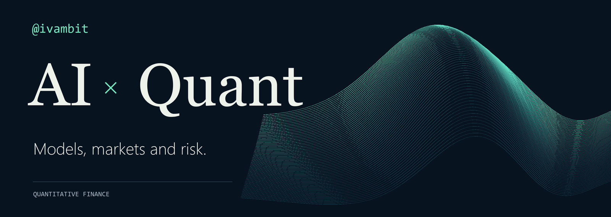

AI agents for financial research and algorithmic trading · Based in Spain.

## What I'm building now

- **AI equity research:** A self-hosted, Spanish-localized workspace built on the open-source LangAlpha agent (FastAPI + React, Docker, Claude Code runtime, MCP market-data tools), with a curated, commit-pinned plugin catalog of quant, wealth-management and investment-banking skill packs.
- **Strategy research:** Intraday gold (XAUUSD) strategies with walk-forward backtests in Python.
- **Trading systems:** MetaTrader 5 Expert Advisors and broker integrations with Interactive Brokers and OKX.
- **Automation:** Telegram bots, n8n workflows and market dashboards.

## Research interests

| Artificial intelligence | Quantitative finance | Automation |
| --- | --- | --- |
| Research agents, MCP tools | Intraday gold, walk-forward testing | Bots, workflows, dashboards |

## Stack

## How I work

- Start with clear questions.
- Make assumptions transparent.
- Evaluate carefully on out-of-sample data.

Nothing here is investment advice.
